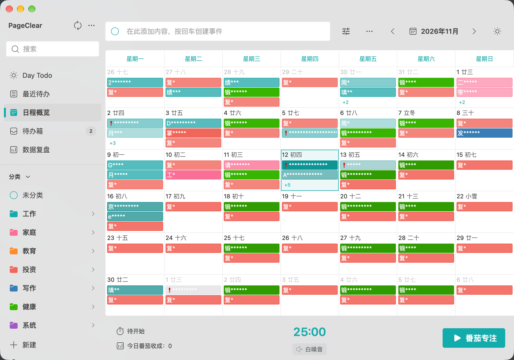
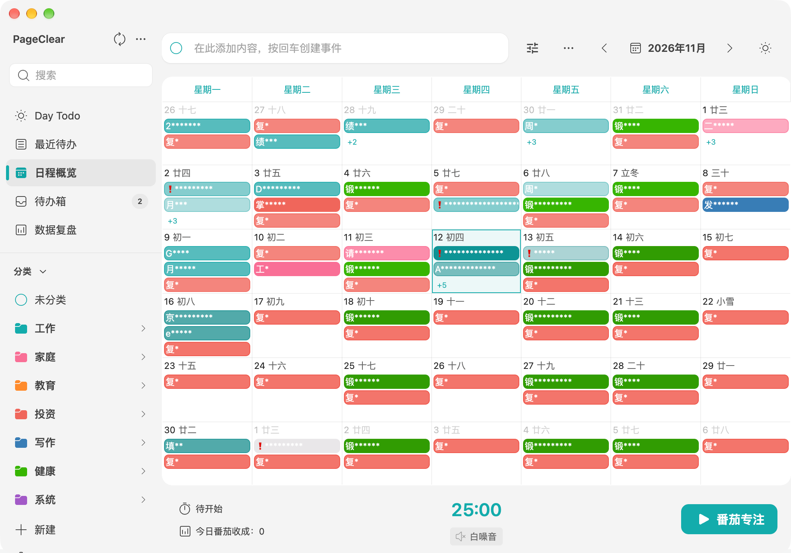
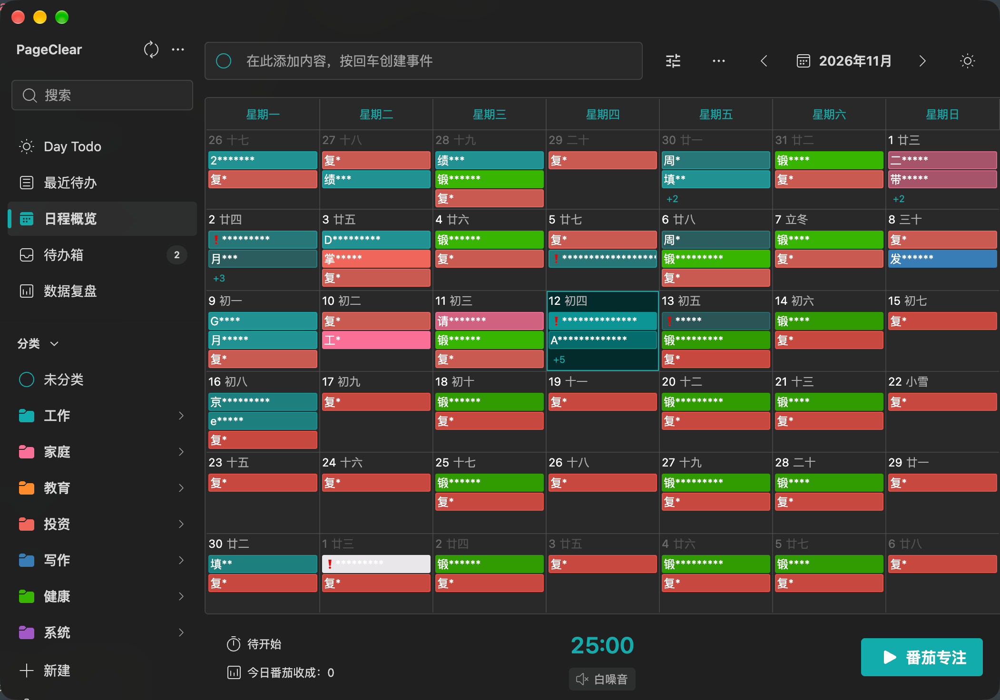
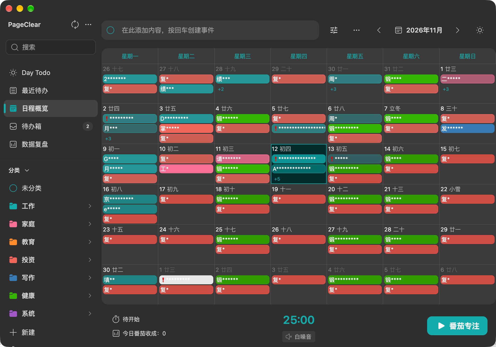

# Todo清单（macOS）优化补丁 · todo-list-hack

> **有问题 / 想反馈 / 想要定制？加我微信：`PageClear`**（备注：Todo清单）

给 **[Todo清单](https://todo.evestudio.cn/)**（EveStudio / 杭州乾夕科技）的 **macOS 桌面客户端**
打的一层**纯本地视觉优化补丁**：关掉主窗口的原生毛玻璃，套一套 macOS 26/27（Tahoe）风格皮肤。

- 官网：<https://todo.evestudio.cn/>（文档里提到"官网"都指这里）
- 适配版本：**Todo清单 4.0.x macOS 桌面版**（Electron 打包，默认安装在 `/Applications/Todo清单.app`）
- 技术手段：解开 App 包里的 `app.asar` → 改**一行窗口参数** + 在 `css/index.*.css` 末尾**追加一段 CSS** → 重新打包并 ad-hoc 重签名
- 不改业务逻辑、不联网、不上传任何数据；与官方无关，属第三方个人修改

---

## 📮 联系方式

| 渠道 | 信息 |
|---|---|
| **微信（最快）** | **`PageClear`** ← 复制搜索，加好友时请备注「Todo清单」 |
| 仓库 | <https://github.com/ivaneye/todo-list-hack> |

---

## 一、为什么需要它

macOS 版客户端基于 Electron，界面在系统层面用了三样东西，在真实使用中会带来三个问题：

| # | 官方实现 | 实际问题 |
|---|---|---|
| 1 | 主窗口开了原生毛玻璃 `vibrancy: "titlebar"` + 透明背景 | 窗口背后只要是深色内容（深色壁纸、其他深色窗口），**整块界面就发灰发脏**，白卡片看起来像蒙了层灰 |
| 2 | 界面沿用旧版设计语言（方角卡片、1px 分割线、灰色外壳） | 与 macOS 26/27 的"大圆角卡片 + 细投影 + 中性灰外壳"不一致，**看起来不像这个系统上的原生应用** |
| 3 | 侧边栏、日期条、日历事件块都是直角/硬边框 | 长时间盯着用眼累，日历区域密密麻麻 |

本工具只解决这三件事，其余一律不动：**不新增功能、不改数据、不改快捷键、不动同步。**

## 二、前后对比

四张图都是同一份界面（**日程概览**，2026 年 11 月），左边官方原版，右边打完补丁。

**亮色主题**

| 官方原版 | 打补丁后 |
|---|---|
|  |  |

**暗色主题**

| 官方原版 | 打补丁后 |
|---|---|
|  |  |

不用放大也能看出来的差别：

| # | 位置 | 官方原版 | 打补丁后 |
|---|---|---|---|
| 1 | 窗口底色 | 近纯黑（暗）/ 偏灰（亮），且受背后窗口影响发脏 | 实心中性色：亮 `#f4f4f4`、暗 `#2e2e2e`，背后是什么都不影响 |
| 2 | 内容区 | 与外壳同色，一整片平铺 | 独立**白卡片，14px 圆角 + 极淡投影**，与外壳分层（暗色 `#3a3a3a`） |
| 3 | 日历事件块 | 2px 直角块 | **6px 圆角**，同一列不再“糊成一条” |
| 4 | 日历网格线 | 明显的 1px 分隔线，画面碎 | 降到 6%，只留阅读锚点 |
| 5 | 顶部输入框 / 搜索框 | 方角、与背景同色 | 12px 圆角，边界靠底色区分 |
| 6 | 侧边栏选中项 | 通栏直角色块 | 8px 圆角药丸，缩进对齐图标 |
| 7 | 待办列表行 | 每行 1px 分割线 | 去掉分割线，悬停变 10px 圆角药丸（**行高不变**，虚拟滚动不受影响） |
| 8 | 暗色整体 | `#1c1c1c` 近纯黑，对比过强 | 外壳/卡片/输入框/编辑面板统一到同一层，久看不刺眼 |

其余细节：滚动条改细胶囊，按钮 8px 圆角，字体统一 `-apple-system` / SF Pro，明暗两套主题都覆盖。
配色、圆角想自己调？只改 `todo-glass-off/skin.css` 再跑一次脚本即可。

## 三、快速开始

```bash
git clone https://github.com/ivaneye/todo-list-hack.git
cd todo-list-hack/todo-glass-off

./patch.sh          # 打补丁 + 装皮肤（结束自动体检）
```

就这一条命令。它自己会：

1. 找 Node.js；**没有就自动下载安装**（见下节，无需 sudo、不动系统环境）
2. 退出 Todo清单 → 首次运行备份原始 `app.asar` 到 `backup/`
3. 解包 → 关毛玻璃 + 写入皮肤 → 重新打包 → ad-hoc 重签名
4. 断言落盘结果 + 清渲染缓存 + 用调试端口跑一次真实体检（滚轮、圆角、玻璃）
5. 重启应用

其他入口：

```bash
./patch.sh --diag      # 只看当前状态（版本/是否已关玻璃/是否已装皮肤/指纹/备份）
./patch.sh --no-verify # 只打补丁，不跑体检
./verify.sh            # 单独体检
./revert.sh            # 还原官方原版（毛玻璃回来、皮肤去掉）
```

App 不在默认路径：`TODO_APP="/Users/xxx/Applications/Todo清单.app" ./patch.sh`

### 关于 Node.js（按需自动安装）

脚本需要 **Node.js 22+** 来解包 / 重新打包 `app.asar` 和做体检（体检用了全局 `fetch` / `WebSocket`）。
**你不需要提前装**：

- 先找系统里已有的（`PATH`、Homebrew、nvm、`~/.volta` 都会认），**版本够用就直接用，不下载任何东西**；
- 都没有才自动下载官方 Node.js 最新 LTS，**只解压到本目录 `.tools/node`**，并做 sha256 校验；不写系统目录、不需要 sudo、不碰你已有的 node；
- 下载源官方 `nodejs.org` 优先，失败自动切 `npmmirror`；也可手动指定：
  ```bash
  TODO_NODE_MIRROR=https://cdn.npmmirror.com/binaries/node ./patch.sh
  ```
- 不想让它联网安装：`TODO_NO_INSTALL_NODE=1 ./patch.sh`（缺 node 会直接报错并给出手动安装方式）
- `.tools/` 已在 `.gitignore` 里，不会进 git

## 四、目录结构

```
todo-list-hack/
├── README.md                  # 本文件
├── docs/images/               # 前后对比截图（亮色/暗色 × 修改前/后）
└── todo-glass-off/            # 补丁本体
    ├── patch.sh               # 主入口：打补丁 + 装皮肤 + 自检
    ├── revert.sh              # 还原官方原版
    ├── verify.sh              # 体检（拉起调试端口 → 检查 → 重启）
    ├── skin.css               # ← 皮肤源码，只改这一个文件
    ├── lib/
    │   ├── env.sh             # 公共环境：找 Node.js / 缺了自动装 / App 定位 / 空闲端口
    │   ├── asar-tool.js       # 无依赖 asar 解包 / 打包 / 差异校验
    │   ├── bake.js            # 注入窗口参数与皮肤（带皮肤安全检查）
    │   └── verify.js          # 体检实现（CDP，真实滚轮事件）
    ├── dev/                   # 调试辅助（CDP 客户端、截图、预览），日常用不到
    ├── backup/                # 运行时生成：原始 app.asar / 版本 / 皮肤指纹（不进 git）
    └── .tools/                # 运行时生成：自动安装的 Node.js（不进 git）
```

## 五、它到底改了什么

| 位置 | 改动 | 量级 |
|---|---|---|
| `app.asar → background.js` | macOS 分支窗口选项 `{backgroundColor:"#00000000", vibrancy:"titlebar", visualEffectState:"followWindow"}` → `{backgroundColor: 亮色/暗色实色}` | **一行** |
| `app.asar → css/index.*.css` | 末尾追加 `skin.css`，用 `/* @macos-skin start */ … end` 包裹 | 一段 CSS |

一次完整流程的安全性设计：

- **失败即中止**：解包/检查/打包任何一步失败都在**替换前**退出，不会留下半个包
- **皮肤安全检查**：`bake.js` 会拦下两类已知会把 App 改坏写法的 CSS
  （给滚动容器加 `overflow:hidden` → 滚轮失效；改待办行竖向 margin/height → 虚拟滚动错位）
- **安装后断言**：确认落盘 asar 里「没有 vibrancy、有皮肤标记、体积正常」，不满足直接报错
- **原版备份**：首次运行把官方 `app.asar` 复制到 `backup/`（含版本号），`revert.sh` 靠它还原本机
- **清渲染缓存**：CSS 文件名不变，不清 Chromium 磁盘缓存可能看不到新样式

## 六、风险与免责（请先看）

1. **改了官方 App 包**：会 ad-hoc 重新签名，因此
   - 应用内**自动更新可能失败或被覆盖** → 升级后重跑 `./patch.sh` 即可；
   - 首次启动可能要重新允许**通知 / 日历**等系统权限；
   - 若被 Gatekeeper 拦：系统设置 → 隐私与安全性 → 「仍要打开」。
2. **官方升级后**：重跑 `./patch.sh`；版本结构变大了（找不到目标代码）脚本会**明确提示并中止**，不会打包出坏应用。
3. **皮肤依赖类名**：`.todo-page-surface`、`.todo-list-item` 等是这版前端的语义类。官方改名则对应规则**静默失效退回原样**（不会白屏），`./patch.sh --diag` 能看出来。
4. **合规**：本仓库**不含**官方任何二进制（`backup/` 里的 `app.asar` 是从你自己机器上备份的，已排除在 git 之外）。请自行评估使用风险；如果你是该应用作者且不希望此类修改存在，联系我即删。
5. **恢复官方**：`./revert.sh`，或删掉 App 从[官网](https://todo.evestudio.cn/)重新下载安装。

## 七、常见问题

| 现象 | 原因 / 处理 |
|---|---|
| 打完还是原本的样子 | `./patch.sh --diag` 看「含皮肤标记」：否 = 没打进去（多半跑的是另一份脚本副本）；是但仍没变化 = 缓存，`./verify.sh` 再重启一次 |
| 圆角有但滚轮失灵 | 皮肤给滚动容器加了 `overflow:hidden`，`bake.js` 已内置拦截；改完 `skin.css` 重跑 |
| 列表滚错位 | 给 `.todo-list-item` 改了竖向 margin/padding（虚拟列表按行高算），已内置拦截 |
| 体检连不上调试端口 | 已改为**自动挑空闲端口**；若 App 启动时本身带了调试参数，脚本会读 `DevToolsActivePort` 校正 |
| 想换配色 | 只改 `skin.css` 顶部两处 `background`，再 `./patch.sh`（按文件指纹判断要不要重烘） |
| App 升级后没皮肤了 | 正常，重跑 `./patch.sh`（会自动重新备份新版本原始包） |

## 八、命令行 / 对话式管理待办（CLI 在另一个目录）

`todoctl`（见 `../cli/`）可以查、增、改、完成、删除、子任务、标签、番茄……走的是 App 自己的
Vuex action，和你点按钮同一条代码路径。它**不需要改 App**，因此和本仓库的皮肤补丁互不影响：

- 查询：直接读 App 的数据文件（`todos.db` + `critical-state-backup.json`），App 都不用开
- 写入：用 Electron 主进程的 `--inspect` 本地接口，临时启动/重启 App，**不改 asar、不重签**

> 早期的「CDP 补丁」方案（`./bridge.sh install` 往 `background.js` 里塞 `remote-debugging-port`）
> 已经删除——它需要改 asar + 重签、App 升级后失效，而且等于给本机任何进程开了调试端口。

## 九、维护者备忘（踩过的坑）

| 坑 | 现象 | 正确做法 |
|---|---|---|
| 给 `.todo-page-surface` 加 `overflow:hidden` | 待办列表滚轮完全失灵 | 用 `clip-path: inset(0 round 14px)` |
| 给 `.todo-list-item` 加竖向 margin/padding | 虚拟列表高度算错、滚动错位 | 只允许水平 `margin: 0 6px` |
| 原地改 CSS 但文件名不变 | 命中 Chromium 磁盘缓存，样式不生效 | 装完清 `Cache` / `Code Cache`（已内置） |
| macOS 自带 bash 是 3.2 | `$VAR` 紧跟全角括号（如 `$X）`）→ `unbound variable` 中途退出，出现"半套补丁" | 一律写 `${VAR}` |
| macOS 12+ 不带 `python3` | 老版本注入脚本在干净机器上直接失败 | 现在只用 Node（`lib/asar-tool.js`），字节级原样往返 |
| 体检硬编码 9222 | 端口被 VS Code 等占用就连不上 | 自动挑空闲端口 + 读 `DevToolsActivePort` 校正 |
| 用两份脚本副本 | 一份装了一套，另一份又覆盖 | 只在同一目录维护，装完看「安装后断言」 |

---

**联系我**：微信 `PageClear`（备注「Todo清单」）。

**License**：脚本与皮肤（本仓库代码）MIT。修改的是你本机安装的 App，官方应用版权归 EveStudio 所有。
