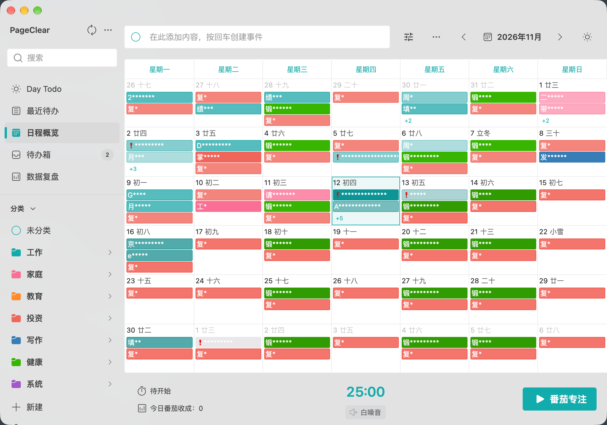
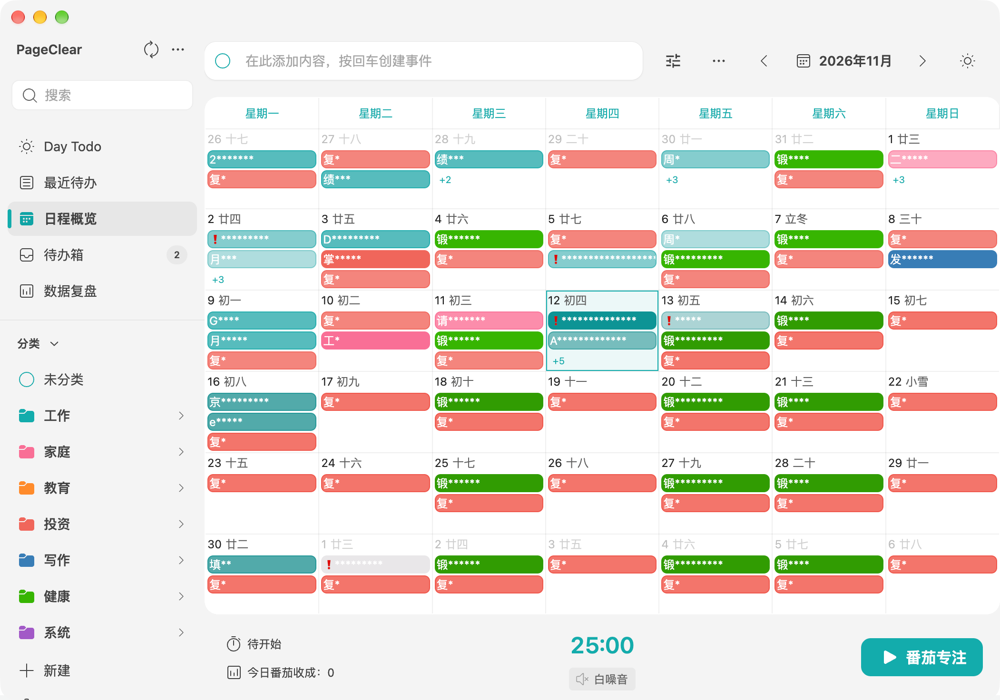
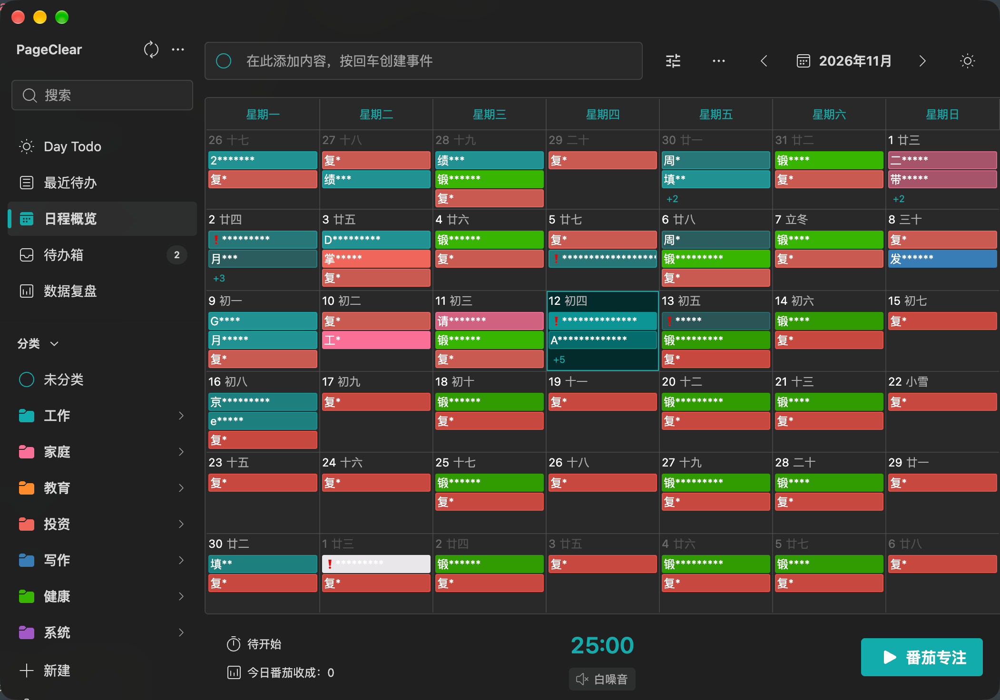
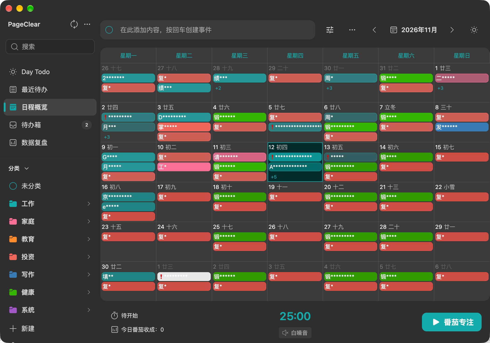

# Todo清单（macOS）· 关玻璃 + 视觉皮肤

给 **Todo清单 4.x（Electron / macOS）** 打的一层本地补丁：

1. **关掉主窗口的原生毛玻璃（vibrancy）** —— 背后是深色窗口时整块界面发灰发脏的根因；
2. **注入一套 macOS 26/27 风格皮肤** —— 白卡片、14px 圆角、细投影、去分割线、中性灰外壳、日历事件圆角，明暗两套。

> 本工具只改本机已安装的 App 包内的 `app.asar`（`background.js` 一行 + 追加一段 CSS），
> 不改逻辑、不联网、不收集数据。与官方无关，属第三方个人修改，请自行评估使用。

---

## 一、环境要求

| 项 | 要求 |
|---|---|
| 系统 | macOS 12+ |
| Node.js | **22+**（解包/打包 `app.asar`、体检用全局 `fetch`/`WebSocket`）。**没装也行**：脚本会自动下载官方 LTS 到本目录 `.tools/node`，不动系统 node、不需要 sudo |
| 应用 | Todo清单 4.0.x（macOS 版，安装后位于 `/Applications/Todo清单.app`） |
| 权限 | 需要对 `/Applications` 有写权限（管理员账号即可） |

## 二、用法

```bash
cd todo-glass-off

./patch.sh              # 打补丁 + 皮肤（结束会自动体检）
./patch.sh --no-verify  # 只打补丁，不体检
./patch.sh --diag       # 只打印当前状态，不做修改
./verify.sh             # 单独跑一次体检（自动挑空闲调试端口）
./revert.sh             # 还原官方原版（毛玻璃回来，皮肤去掉）
```

**Node.js 是自动的**：先找系统里已有的（`PATH` / Homebrew / nvm / `~/.volta`），版本够用就直接用；
都没有才下载官方最新 LTS 到 `.tools/node`（sha256 校验，官方源失败自动切 npmmirror）。

| 想改行为 | 怎么做 |
|---|---|
| 不自动下载 | `TODO_NO_INSTALL_NODE=1 ./patch.sh` |
| 指定镜像 | `TODO_NODE_MIRROR=https://cdn.npmmirror.com/binaries/node ./patch.sh` |
| 指定 node | `TODO_NODE_BIN=/opt/homebrew/bin/node ./patch.sh` |

**应用升级后**：再跑一次 `./patch.sh` 即可 —— 脚本会检测版本、自动重新备份新版原始包、重打补丁并自检。

App 不在默认路径时：

```bash
TODO_APP="/Users/xxx/Applications/Todo清单.app" ./patch.sh
```

## 三、改了哪些东西

前后对比（亮色 / 暗色，左官方原版、右打补丁后）：

| 主题 | 官方原版 | 打补丁后 |
|---|---|---|
| 亮色 |  |  |
| 暗色 |  |  |

更详细的对比说明见仓库根 `../README.md` 第二节。

| 文件 | 改动 |
|---|---|
| `app.asar → background.js` | macOS 分支 `{vibrancy:"titlebar", backgroundColor:"#00000000"}` → 实心背景 `{backgroundColor:"#202020"/"#f3f3f3"}`，窗口不再透明 |
| `app.asar → css/index.*.css` | 末尾追加 `skin.css`（`/* @macos-skin start */` … `/* @macos-skin end */`） |

皮肤内容（纯视觉，不改尺寸/逻辑）：

- 外壳中性灰 `#f4f4f4`（暗色 `#2e2e2e`），内容卡片 14px 圆角 + 极淡投影
- 待办行去掉 1px 分割线，悬停变 10px 圆角药丸
- 日期条/输入框 12px 圆角；按钮 8px
- 侧边栏项 8px 药丸；滚动条改细胶囊
- 日历事件块 2px → 6px 圆角，网格线降到 6%
- 字体统一 `-apple-system` / SF Pro
- 暗色表面色 `#3a3a3a`（卡片、日期条、输入框、右侧编辑面板同色）

## 四、目录结构

```
todo-glass-off/
├── patch.sh          # 主入口
├── revert.sh         # 还原
├── verify.sh         # 体检（调试端口拉起 → 检查 → 正常重启）
├── bridge.sh         # 可选：开/关本地自动化接口（127.0.0.1）
├── skin.css          # ← 皮肤源码，只改这里
├── lib/
│   ├── env.sh        # 公共环境：找 Node.js（缺了自动装）/ App 定位 / 空闲端口
│   ├── asar-tool.js  # 无依赖 asar 解包/打包/差异校验
│   ├── bake.js       # 注入窗口参数与皮肤（含皮肤安全检查）
│   ├── verify.js     # 体检实现（CDP，真实滚轮事件）
│   └── inject-bridge.js  # bridge.sh 用的注入器（用 Node 替代 python3）
├── dev/              # 调试辅助，普通用户用不到
├── backup/           # 运行时生成：原始 app.asar / 版本 / 皮肤指纹（不进 git）
├── .tools/           # 运行时生成：自动安装的 Node.js（不进 git）
└── README.md
```

## 五、风险与副作用（请先看）

1. **会重新签名（ad-hoc）**：修改后的 App 由本机临时签名，因此
   - 应用内**自动更新会失败或被覆盖** → 每次升级后重跑 `./patch.sh`；
   - 首次启动可能需要重新允许**通知 / 日历**等系统权限；
   - 若被 Gatekeeper 拦，去「系统设置 → 隐私与安全性」点「仍要打开」。
2. **皮肤依赖类名**：`.todo-page-surface`、`.todo-list-item` 等是这版前端的语义类。
   官方若改名，对应规则会**静默失效退回原样**（不会白屏），脚本也会在 `--diag` 里看得出来。
3. **版本变化要重跑**：新版结构若变了，脚本会打印「未找到目标代码」并**在替换前中止**，不会打出坏包。
4. **`backup/` 不要分发**：里面是官方原包，仅本机回滚用（已在 `.gitignore` 里排除）。

## 六、常见问题

| 现象 | 原因 / 处理 |
|---|---|
| 发布包里为什么没有 `backup/` | 每个人的原版包由 `./patch.sh` **首次运行时自动备份**（App 当前的 `app.asar` 复制到 `backup/`，并记录版本号）；`revert.sh` 就靠它回滚。所以分发包里不需要、也不应该带官方原包 |
| 打完还是方的、没皮肤 | 跑 `./patch.sh --diag`，看「含皮肤标记」是否为「是」；为「否」说明没打进去（多半是用了旧版脚本或另一份拷贝） |
| 圆角有但滚轮失灵 | 皮肤里给滚动容器加了 `overflow:hidden`。`bake.js` 已内置拦截，改 `skin.css` 后重跑即可 |
| 列表滚动错位 | 给 `.todo-list-item` 改了竖向 margin/padding（虚拟列表按行高计算），已内置拦截 |
| 自动化体检连不上 | 已改为自动挑空闲端口；仍失败可用 `PORT=9333 ./verify.sh` 指定；装了本地接口时 App 会自己开随机端口，脚本会读 `DevToolsActivePort` 校正 |
| 想改配色 | 只改 `skin.css` 顶部的两个 `background`，然后 `./patch.sh` |

## 七、卸载 / 还原官方

```bash
./revert.sh
```

或直接删掉 App，从官网重新下载安装（等价于还原）。

## 八、可以自己调的地方

`skin.css` 里最常改的两处：

```css
/* 外壳亮色 */
background: #f4f4f4 !important;   /* #fafafa 更淡 → #f7f7f7 → #f4f4f4 → #f0f0f0 更明显 */

/* 外壳暗色（表面色在下面 token 覆盖处，要与它保持 ~12 级差） */
background: #2e2e2e !important;   /* 表面色 #3a3a3a */
```

改完执行 `./patch.sh`（脚本按 `skin.css` 指纹判断是否需要重新烘焙）。

## 九、已知踩坑（维护者备忘）

| 坑 | 现象 | 正确做法 |
|---|---|---|
| 给 `.todo-page-surface` 加 `overflow:hidden` | 待办列表滚轮完全失灵 | 用 `clip-path: inset(0 round 14px)`，不影响滚动与命中测试 |
| 给 `.todo-list-item` 加竖向 margin/padding | 虚拟列表高度算错、滚动错位 | 只允许水平 `margin: 0 6px` |
| 原地改 CSS 但文件名不变 | 可能命中 Chromium 磁盘缓存，样式不生效 | `patch.sh` 装完会清 `Cache` / `Code Cache` |
| bash 3.2 中 `$VAR` 紧跟全角括号 | `unbound variable` 中途退出，出现"半套补丁" | 写 `${VAR}` |
| macOS 12+ 不自带 `python3` | 老 `bridge.sh` 在干净机器上注入失败 | 改用 `lib/inject-bridge.js`（Node，latin1 字节级往返） |
| 体检写死 9222 端口 | 被 VS Code 等占用就连不上；装了 bridge 时 App 又是随机端口 | 自动挑空闲端口 + 启动后读 `DevToolsActivePort` 校正 |
| 体检不等页面渲染 | 刚启动 DOM 为空，误报「待办行不存在」 | `lib/verify.js` 轮询等 `.page__main` 出来再断言 |
| 用两份脚本副本 | 一份装了一套，另一份覆盖掉 | 只在同一个目录维护，装完看「安装后断言」 |

---

## 十、命令行 / 对话式管理待办

已拆分到独立目录：`../cli/`（`todoctl` + `bridge.sh` + 自己的 README）。
> 注意：`cli/` **不在本仓库**（未公开）。本仓库只有 `bridge.sh` —— 负责开/关本地接口，不含 `todoctl` 本身。
本目录只负责**样式与 App 打包**（皮肤补丁、还原、体检）。

两个目录的关系：

- `todo-glass-off/`：改 `app.asar` 里的窗口参数与 CSS（皮肤），并提供 asar 打包工具与原始包备份
- `cli/`：通过 CDP 操作已运行的 App（`todoctl`），其 `bridge.sh` 是一个转发脚本，
  实际复用本目录的 `asar-tool.js` 与 `backup/`
